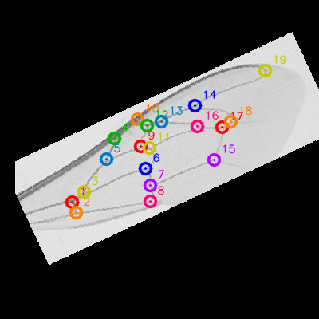
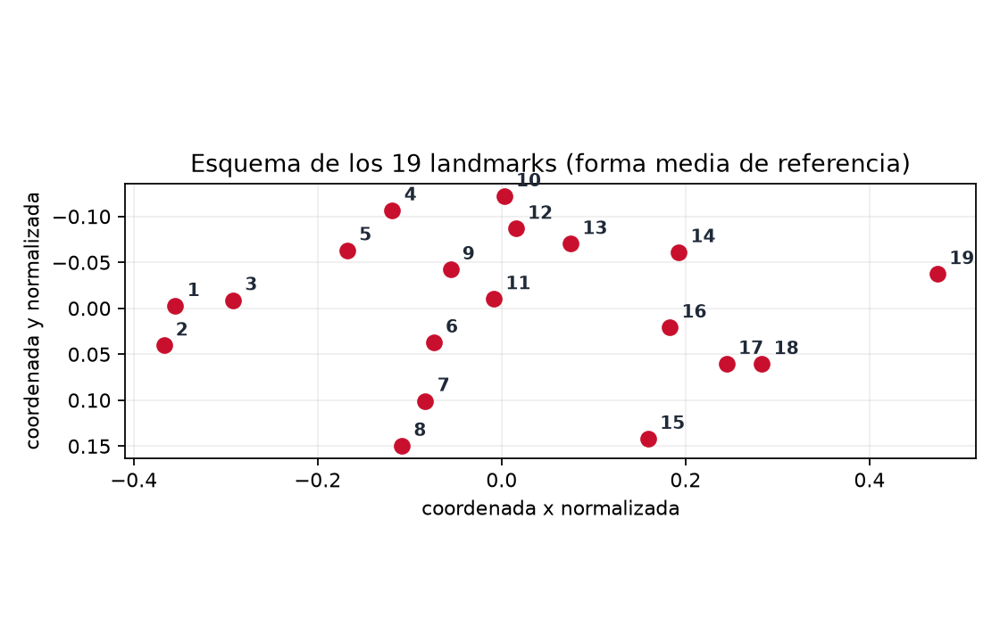

# manganga-landmarks

Detección automática de los **19 landmarks del esquema de Ruttner** en el ala anterior
derecha de *Apis mellifera*, mediante morfometría geométrica + deep learning.

> Fork de [walterBSG/Beeapp-landmark-detection](https://github.com/walterBSG/Beeapp-landmark-detection)
> orientado a poblaciones de abejas de Uruguay. Ver [Atribución](#atribución).

```
foto del ala ──▶ (recorte opcional) ──▶ letterbox 400×400 ──▶ CLAHE ──▶ U-Net
             ──▶ centros de los discos ──▶ ordenamiento Procrustes ──▶ 19 landmarks
```



*Salida de ejemplo: los 19 puntos ordenados sobre las intersecciones de venas
(overlay generado por `manganga detect`).*



*Esquema de numeración (forma media de referencia). Usalo para digitalizar a mano en
el mismo orden: `python scripts/reference_figure.py -o docs/img`.*

**Salida**: `.tps` (compatible tpsDig/MorphoJ), `.csv` y overlay PNG con los puntos numerados.

> Las coordenadas salen en el **marco normalizado 400×400** (letterbox + CLAHE), que es
> el que ve la red. Si usás `--crop`, ese marco corresponde al ala recortada, no a la
> foto original.

---

## Estado

| Fase | Descripción | Estado |
|---|---|---|
| F0 | Fork, remotes, licencia y documentación | ✅ |
| F1 | Dataset validado + U-Net reentrenable | ✅ (entrenamiento real pendiente de GPU) |
| F2 | Detección y ordenamiento robusto de puntos | ✅ |
| F3 | CLI (`detect`, `batch`, `train`, `validate-data`) | ✅ |
| F4 | Heatmaps de 19 canales (opcional) | ⏳ |
| F5 | Protocolo de fotografía + datos de Uruguay | ⏳ |

## Instalación

Requiere **Python 3.10-3.12** (en macOS Intel: 3.11).

Con [uv](https://docs.astral.sh/uv/) (rápido, no necesita brew):

```bash
uv python install 3.11
uv venv --python 3.11 .venv
uv pip install --python .venv/bin/python -r requirements.txt
uv pip install --python .venv/bin/python -e . --no-deps
source .venv/bin/activate
```

O con venv clásico:

```bash
python3.11 -m venv .venv
source .venv/bin/activate
pip install -r requirements.txt
pip install -e . --no-deps
```

Con `make`:

```bash
make setup     # crea el entorno e instala todo
make test      # corre los tests
make validate  # valida el ground truth de masks/
```

> En macOS Intel (x86_64) la última versión de PyTorch con wheel es **2.2.2** y no hay
> soporte de GPU: sirve para inferencia y pruebas, pero el entrenamiento completo
> conviene hacerlo en Colab/Kaggle (ver [`notebooks/train_unet.ipynb`](notebooks/train_unet.ipynb)).

## Uso

### Una sola foto

```bash
manganga detect -i ala.jpg -o out/
# out/landmarks/ala.tps  out/landmarks/ala.csv  out/overlays/ala.png
```

Si la foto es cruda (no recortada):

```bash
manganga detect -i foto_placa.jpg -o out/ --crop
```

### Lote completo

```bash
manganga batch -i fotos/ -o out/
# además de los .tps/.csv/overlays, escribe out/report.csv
```

### Entrenar

```bash
# GPU (Colab/Kaggle) — calidad completa
manganga train --data-dir . --epochs 40 --batch-size 16

# CPU (smoke test local, macOS Intel)
manganga train --data-dir . --size 256 --base 16 --max-train-samples 500 --epochs 5
```

La métrica reportada es la del paper: **% de alas con los 19 puntos detectados y
ordenados correctamente**. Checkpoint en `out/checkpoints/best.pt`.

### Validar el ground truth

```bash
manganga validate-data --mask-dir masks --dump-worst 12
```

Extrae los discos de cada máscara, los ordena contra la referencia y mide la
disparidad Procrustes. Sirve para detectar máscaras mal construidas antes de entrenar.

## Estructura

```
manganga/
├── preprocess.py        letterbox + CLAHE (igual que el upstream)
├── crop.py              recorte clásico del ala (reemplaza el SSD original)
├── io.py                .tps / .csv / overlays
├── detect.py            inferencia: foto -> 19 landmarks
├── train.py             entrenamiento (weighted BCE + augmentation)
├── cli.py               interfaz de línea de comandos
├── assets/
│   └── reference_19.txt forma de referencia Procrustes (19 puntos)
├── landmarks/
│   ├── blobs.py         centros de los discos (con fallbacks)
│   └── procrustes.py    alineación Umeyama + ordenamiento húngaro
├── models/unet.py       U-Net en PyTorch
└── data/
    ├── dataset.py       pares ala/máscara + augmentation
    └── validate.py      validación del ground truth
```

## Datos

El repo incluye el dataset del upstream (ya recortado y normalizado):

| Directorio | Contenido | Cantidad |
|---|---|---|
| `train/` | alas (400×400) | 14.116 |
| `masks/` | discos r=4 en los 19 landmarks | 14.116 |
| `test/` | alas de test | 3.531 |
| `test_masks/` | máscaras de test | 3.532 |

**Cómo funciona el ground truth**: las máscaras **no** son segmentaciones de venas, son
discos dibujados sobre los 19 landmarks digitados manualmente (ver `cria_mascara.py`).
La U-Net aprende a predecir esos discos y `manganga.landmarks.detect_dots` recupera sus
centros. Los `.txt` con los puntos manuales originales no fueron publicados.

**Calidad del ground truth** (`manganga validate-data`, ver `out/validation_*.csv`):

| Métrica | Valor |
|---|---|
| Discos por máscara | 44-53 px de área (π·4² ≈ 50) |
| Ruido en las máscaras | motas de 1-38 px |
| Máscaras rotas (les falta un disco) | ~6,5 % |
| Disparidad Procrustes (válidas) | media 0.0053 · p99 0.0083 · máx 0.0099 |

Ese ~6,5 % de máscaras no se puede recuperar (el disco no está en la imagen): se excluyen
del entrenamiento con `--filter-dir out`. La disparidad del ground truth calibra el umbral
por defecto (`DEFAULT_MAX_DISPARITY = 0.03`, 3× el peor caso válido).

## Protocolo de fotografía

Para que las fotos nuevas entren directo al pipeline:

1. **Ala anterior derecha** (el esquema de 19 puntos está definido para esa ala).
2. Ala **plana** (portaobjetos o cubreobjetos), sin pliegues.
3. **Iluminación difusa y uniforme**, sin brillos especulares sobre las venas.
4. **Fondo claro/oscuro contrastante** con el ala.
5. **Escala constante** entre muestras (la escala se normaliza con Procrustes, pero la
   resolución afecta la precisión de los puntos).
6. Encender la opción de **recorte automático** (`--crop`) si la foto no está recortada.

## Atribución

Este proyecto es un fork de
[Beeapp-landmark-detection](https://github.com/walterBSG/Beeapp-landmark-detection)
(Walter B. S. Gonçalves). El pipeline original y el esquema de landmarks provienen de:

> Gonçalves, W. B. S., et al. *Deep Learning and Geometric Morphometrics for the
> Identification of Honey Bee Subspecies*. Big Data and Cognitive Computing, 6(3), 70, 2022.
> https://www.mdpi.com/2504-2289/6/3/70

El repositorio original **no declara licencia**. La licencia MIT de este fork aplica
únicamente al código nuevo (paquete `manganga/`, scripts, documentación). Ver
[`NOTICE.md`](NOTICE.md).

## Licencia

MIT — ver [`LICENSE`](LICENSE).
